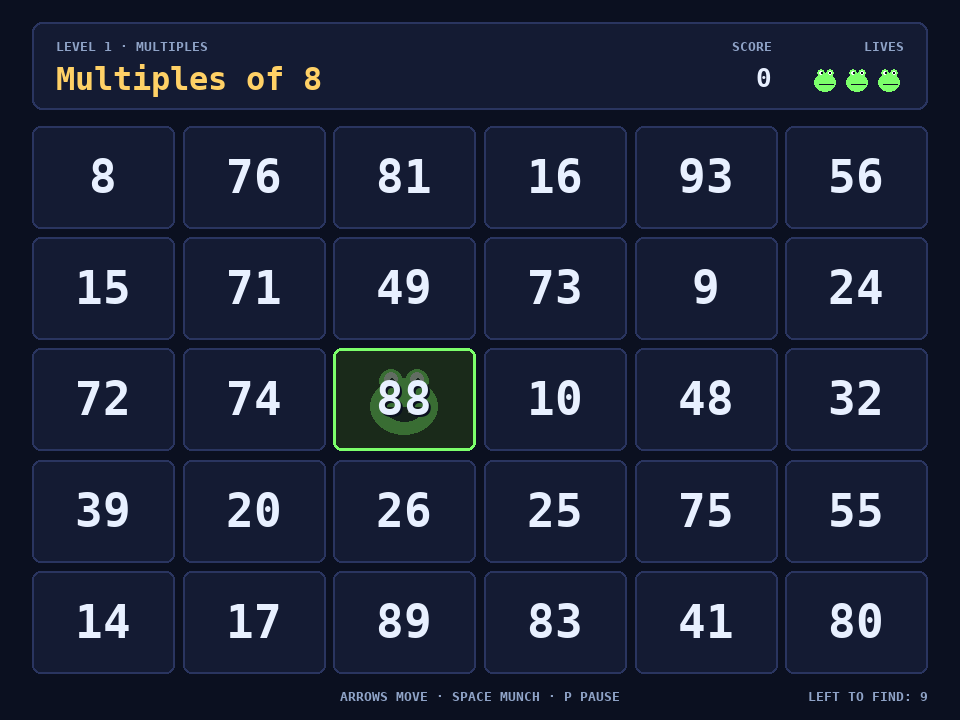

# Number Cruncher

A Number Munchers style math game written in Python with pygame.

Move your Muncher around a 6×5 grid and eat every number that fits the rule
at the top of the screen. Eat a wrong one, or let a Troggle catch you, and you
lose a life. Clear all the matching numbers to finish the level.



## Game types

| Game       | Example rule      | Munch these         |
|------------|-------------------|---------------------|
| Multiples  | Multiples of 7    | 14, 21, 49          |
| Factors    | Factors of 36     | 2, 9, 12            |
| Primes     | Prime numbers     | 7, 11, 13           |
| Equality   | Equals 12         | 3 × 4, 20 − 8       |
| Inequality | Less than 9       | 2 + 5, 16 ÷ 2       |

Difficulty runs from Grade 2 to Grade 5+ and controls the size of the numbers
and which operations appear.

## Controls

| Key          | Action                       |
|--------------|------------------------------|
| Arrow keys   | Move (WASD works too)        |
| Space/Enter  | Munch                        |
| P or Esc     | Pause                        |
| M            | Sound on/off                 |
| F11          | Full screen                  |

## Scoring

- Each correct munch is worth 10 + 5 × level.
- Finishing a level with no mistakes earns 100.
- Time bonus: 100 minus the seconds you took.
- Every third level cleared gives a bonus life (up to 5).

High scores and settings are saved in `~/.local/share/number-cruncher/save.json`.

## Running from source

You need Python 3.9 or newer and pygame 2.1 or newer.

```sh
git clone https://github.com/pjob/number-cruncher.git
cd number-cruncher
sudo apt install python3-pygame fonts-dejavu-core
make run      # play
make test     # unit tests for the puzzle rules
```

On other systems, install pygame with `pip install pygame` and run
`python3 -m number_cruncher`. The game uses DejaVu Sans Mono when it can find
it and falls back to a system monospace font otherwise.

Pass `--fullscreen` to start in full screen.

## Debian package

```sh
make deb        # builds build/number-cruncher_<version>_all.deb
make install    # builds it and installs it with apt
make uninstall
```

Once installed, start it from the app menu (Games → Number Cruncher) or run
`number-cruncher` in a terminal.

## Project layout

```
number_cruncher/
  rules.py     puzzle types and board generation (no pygame needed)
  game.py      screens and the main loop
  sprites.py   the Muncher and Troggle drawings
  sound.py     generated sound effects
  storage.py   high scores and settings
tests/         unit tests for rules.py
packaging/     launcher, .desktop entry, icon and Debian control file
```

## License

MIT. See [LICENSE](LICENSE).
